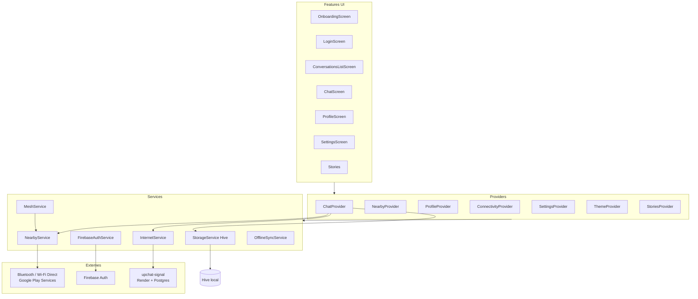
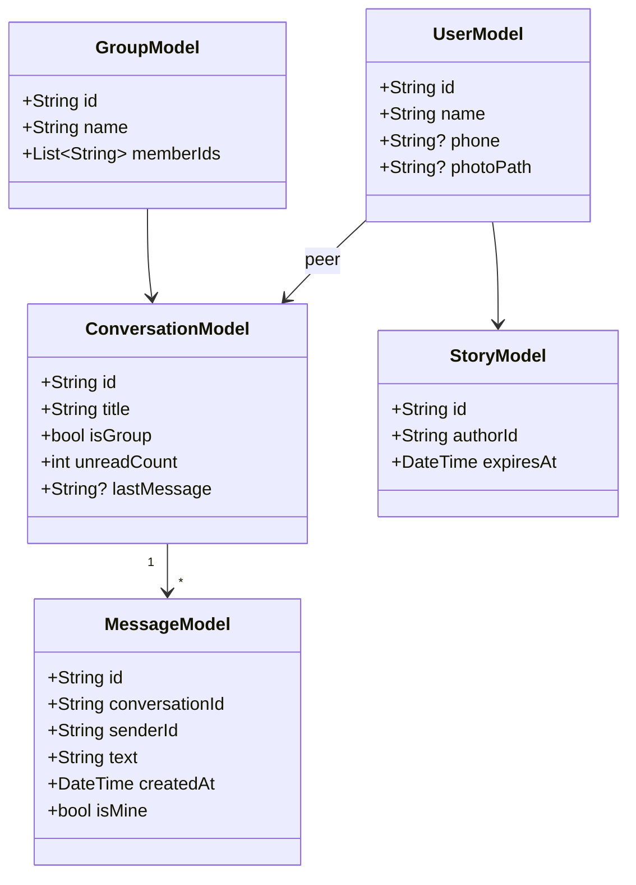
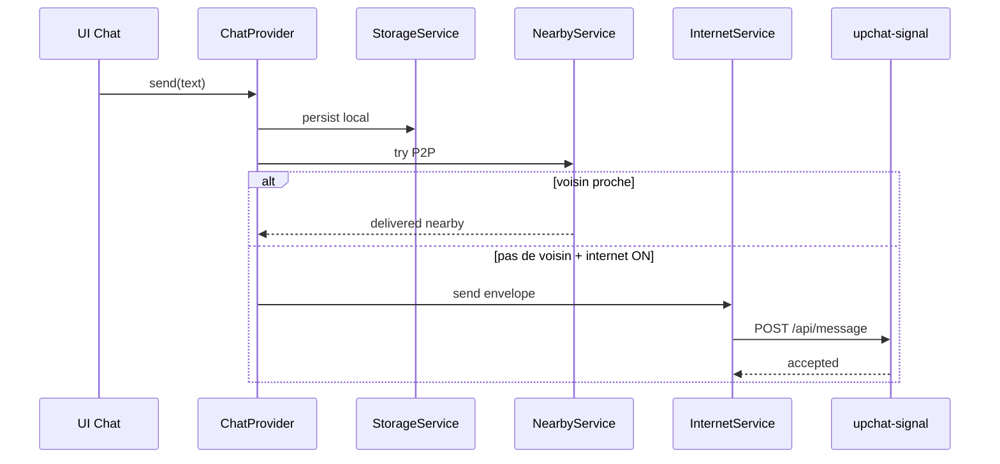

# Architecture UpChat — schéma UML / composants

## Vue composants (client Flutter)

## Domaine (modèles)

## Pipeline envoi message

## Déploiement

| Couche | Hébergement |
|--------|-------------|
| App Android/iOS | GitHub Actions → APK / IPA sideload |
| Web app | GitHub Pages / workflow web |
| Site vitrine | upchat-web (Vercel) |
| Signalisation | **upchat-signal** sur **Render** + Postgres |
| Auth optionnelle | Firebase |
